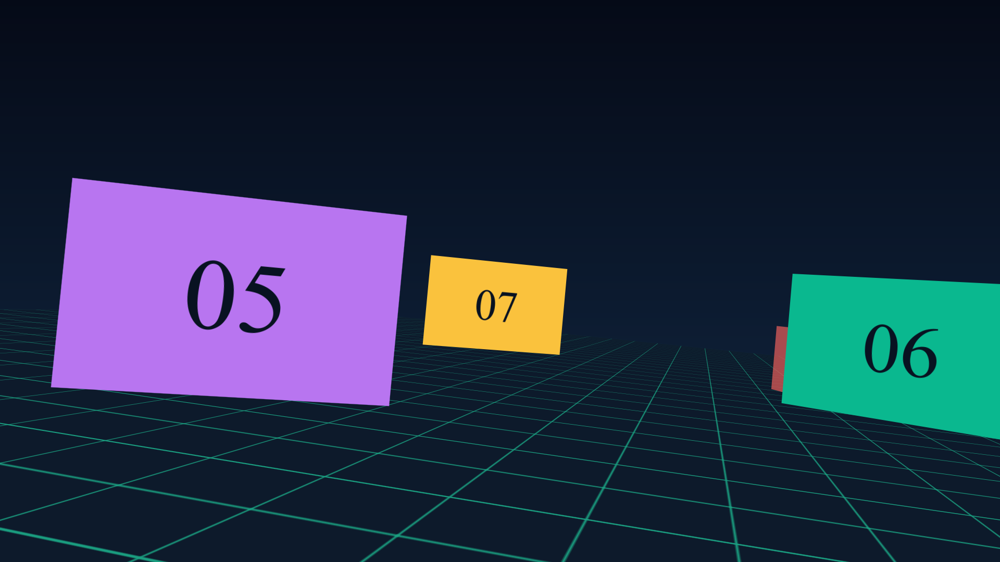
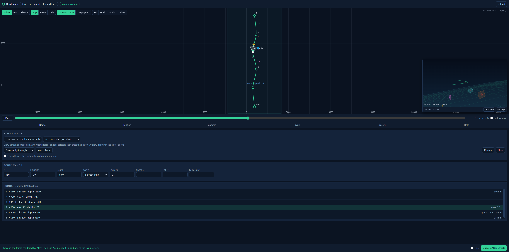

# Routecam

**Draw a path, get a 3D camera flight.** Routecam is a free panel for Adobe After Effects that turns a line or curve you draw into a smooth camera move through your 3D layers, and animates those layers in step with the camera.



Built with AI-assisted development (Claude).

## Who it is for

Motion designers and video editors who want fly-through, orbit, reveal and "camera travels past a row of cards" shots without hand-animating a camera. You do not need to know expressions; Routecam writes them for you and everything it adds stays editable in After Effects.

## What it does

- **Draw the route** in the panel's editor with a Pen tool or freehand Sketch, in Top, Front and Side views, with draggable points and curve handles. Or draw a **mask or shape path** in After Effects and import it. Seven ready-made shapes (S-curve, orbit, spiral, crane and others) are included.
- **Depth and elevation for every point**, by dragging in another view or typing numbers.
- **Timing**: duration, true constant-speed travel, easing at either end, a pause at any point, and a speed multiplier for any stretch.
- **Aim**: look ahead along the route (with smoothing through tight curves), track a 3D layer, or follow a second, independent target path.
- **Roll, banking into turns, focal length and depth of field**, including roll and focal length that change at chosen points.
- **Animate many 3D layers** with position, rotation, scale and opacity, with staggering, either at fixed times or linked to camera progress so that layers come in as the camera approaches them.
- **Presets** for routes and layer animations, saved to your Documents folder.
- **Preview**: a live camera view in the panel, an "AE frame" button that shows the real After Effects render, and "Follow in AE" to move After Effects' time indicator as you scrub.
- **Everything stays editable**: the route is a normal motion path, timing is ordinary keyframes, and each action is one step in Edit > Undo.



## Requirements

- Adobe After Effects 2022 (22.0) or later. Developed and tested on After Effects 2026 (26.5).
- Windows 10 or 11. A macOS installer script is included but has not been tested on a Mac.
- No other software, account, key or internet connection is needed.

## Install (Windows)

1. Download this project: on the GitHub page press the green **Code** button, then **Download ZIP**. Unzip it anywhere (for example in your Documents folder).
2. Close After Effects.
3. Open the unzipped folder and double-click **`Install Routecam.bat`**. A black window appears and ends with "Done". No administrator rights are needed. If Windows shows a blue "protected your PC" box, click **More info**, then **Run anyway**; the file is a plain text script you can open in Notepad.
4. Start After Effects and choose **Window > Extensions > Routecam**.

What the installer does: it copies the `extension` folder to `%APPDATA%\Adobe\CEP\extensions\com.routecam.panel`, and switches on Adobe's "PlayerDebugMode" setting for your Windows user, which After Effects needs in order to load panels that did not come from the Adobe marketplace.

**macOS (untested):** open Terminal, type `sh `, drag `scripts/install.sh` from the unzipped folder into the Terminal window, and press Return. Then start After Effects and open **Window > Extensions > Routecam**.

**To remove Routecam:** delete the `com.routecam.panel` folder named above. Your projects keep working; the camera and layers it created are ordinary After Effects layers.

## Try the sample

- Open **`samples/routecam-sample-flight.aep`** (saved from After Effects 26.5; older versions cannot open it), or
- in any version, open the panel, go to the **Presets** tab and press **Create the sample composition**.

It builds a 12 second composition: the camera weaves between ten numbered cards over a grid floor, pauses once, speeds up, changes focal length, banks into the turns, and each card rises and turns into place as the camera approaches it.

## Using it

1. Open a composition.
2. Draw a route in the editor at the top of the panel:
   - **Pen**: click to add points; click and drag to pull out curve handles; click on the line to insert a point.
   - **Sketch**: drag freehand; the stroke is reduced to a few smooth points.
   - or pick a shape on the **Route** tab and press **Insert shape**,
   - or select a mask or shape path in After Effects and press **Use selected mask / shape path**.
3. Use **Top / Front / Side** to place points in depth and height, or select a point and type **Elevation** and **Depth** on the Route tab. The same place sets a **Pause**, **Speed**, **Roll** or **Focal length** for that point.
4. Press **Apply to After Effects**. With **Live** ticked, later changes are applied as you make them.
5. **Motion** tab: start, duration and easing. **Camera** tab: aim, roll, banking, lens, depth of field.
6. **Layers** tab: tick layers (or press **Use After Effects selection**), pick a preset and press **Animate layers**.

The **Help** tab in the panel lists the keyboard shortcuts.

### What gets added to your composition

| Layer | What it is |
| --- | --- |
| **RC Controller** | A null holding every control as a normal effect. **Route Progress** (0 to 100 %) carries all the timing as keyframes. |
| **RC Route Path** | A 3D null whose position keyframes are the route. Select it to see and reshape the path in the Composition panel. |
| **RC Target Path** | Only when the camera follows a target path. |
| **RC Camera** | A two-node camera driven by the two layers above. |

Animated layers get ordinary keyframes. When linked to the camera they also get two sliders, **RC Start %** and **RC Span %**, and an expression that plays those keyframes against Route Progress.

## Known limits

- **Drawing inside the Composition panel is not possible for a panel like this.** After Effects gives panels no way to draw or receive clicks there (only compiled C++ effect plug-ins can, for their own controls). Routecam has its own editor, and connects to the Composition panel in the two ways After Effects allows: import a mask or shape path drawn with After Effects' Pen tool, and reshape the finished route directly in the Composition panel (select **RC Route Path**, then press **Reload** in the panel).
- **The panel's camera preview is a schematic** (layers as coloured outlines). For the real picture use **AE frame** or **Follow in AE**.
- **One route per composition.**
- **Imported masks are read once**, at the current time. Rectangles, ellipses and stars must first be converted (right-click the path > Convert To Bezier Path). Skew on shape groups is ignored.
- **Reshaping the path in After Effects moves pause and speed-change points slightly**, because those are stored as a percentage of the route. Press **Update After Effects** in the panel to put them back. Plain constant-speed or eased flights are not affected.
- **Banking** is worked out from the horizontal turn of the path, so it does nothing on a vertical climb.
- **Focal length assumes After Effects' default 36 mm film size.**
- **Per-point roll or focal length replaces** the constant value on the Camera tab.
- If you **keyframe a control** on RC Controller yourself (for example Look Ahead %), the panel stops overwriting that control. Route Progress, Roll and Focal Length are always rewritten by a full update.
- **Keyboard shortcuts in the editor** were tested in a browser build of the panel. The hand-over of keys from After Effects to the panel was not covered by the automated tests; the Undo, Redo and Delete buttons in the editor toolbar do the same jobs.
- Tested on one computer. Please report problems as GitHub issues, with the After Effects version and the text shown in the panel's message bar.

## For developers

Routecam is a CEP panel (HTML/JavaScript, no dependencies) plus an ExtendScript host. `docs/ARCHITECTURE.md` explains the design and which Adobe APIs were checked. With Node.js 18 or later installed:

```
npm test                run the route maths tests
npm run preview         open the panel in a browser with a stand-in scene
npm run test:ae         run 62 checks inside a running After Effects (Windows)
npm run build           make a distributable zip in dist/
```

## Licence and credits

MIT License, see [LICENSE](LICENSE). Author: **sombentur**. Third-party notices: [THIRD_PARTY_NOTICES.md](THIRD_PARTY_NOTICES.md).

Adobe and After Effects are trademarks of Adobe Inc. This project is not affiliated with Adobe.

Built with AI-assisted development (Claude).
